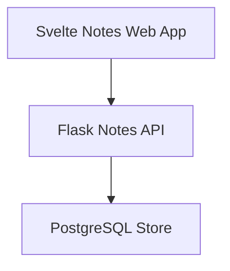
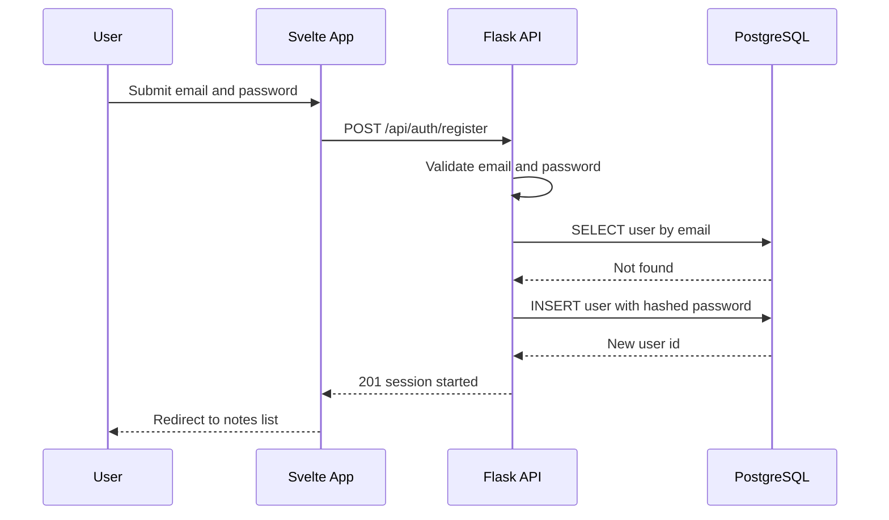
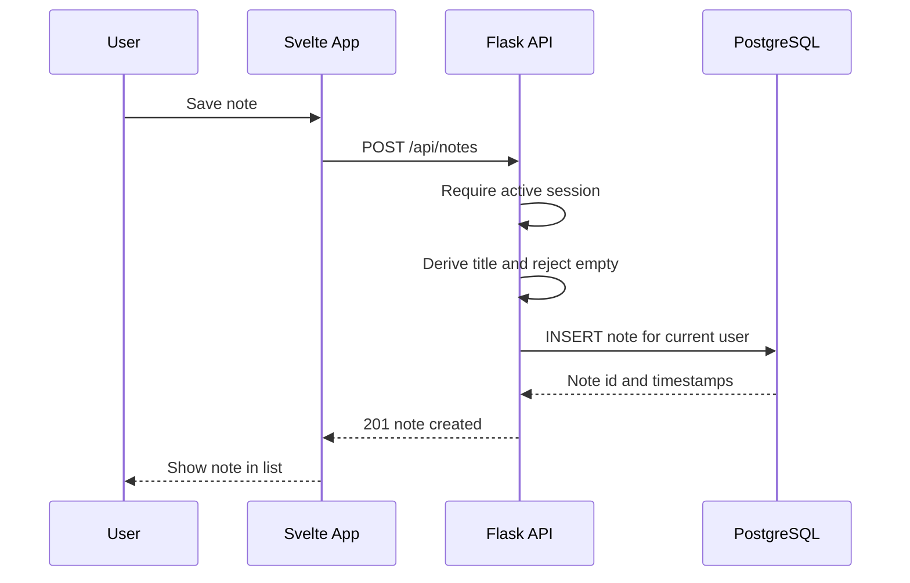
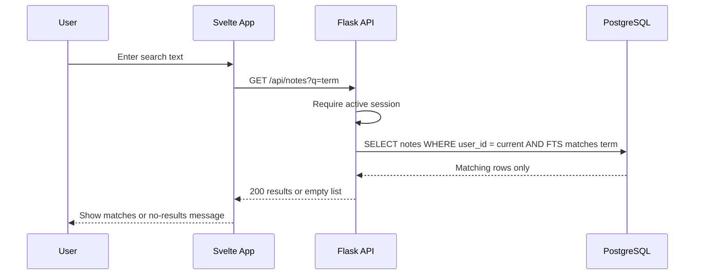
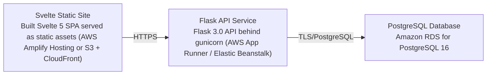

# Architecture

> Maintained by QuorQ AI SDLC. Text between `sdlc:auto` markers is regenerated; anything outside them is yours and is kept.

<!-- sdlc:auto:start narrative -->
## Overview

### ARCH-001 · approved · source: architecture:summary

Overall architecture is a Svelte 5 single-page frontend, Flask 3.0 JSON API backend with session-based auth, and PostgreSQL 16 database, deployed on AWS for modest free personal use.

Approved (v1) architecture for a lightweight personal note-taking web app. Frontend: Svelte 5 SPA. Backend: Flask 3.0 exposing a JSON API with session-based authentication. Database: PostgreSQL 16 storing accounts and notes, with full-text search scoped to each user's own notes. Every note is tied to its owner's account; all read/write access is scoped to the signed-in user so one user can never reach another's notes. Deployed on AWS using managed app hosting plus managed PostgreSQL, sized for modest free personal use.

### ARCH-002 · approved · source: architecture:components

Three components: Svelte 5 web frontend, Flask 3.0 API backend, and PostgreSQL 16 database.

web_frontend - Svelte Notes Web App (Svelte 5): responsive browser UI for registration, sign-in/out, notes list, note view/create/edit/delete, and search; calls the backend JSON API and renders results. api_backend - Flask Notes API (Flask 3.0): handles authentication and sessions, validates input, enforces per-user ownership on every note operation, and runs CRUD plus full-text search against PostgreSQL. database - PostgreSQL Store (PostgreSQL 16): durable storage of user accounts (with hashed passwords) and notes with created/updated timestamps, plus full-text search over a user's own notes.

**Related:** NFR-004

### ARCH-003 · approved · source: architecture:critical_paths

Three critical paths defined: account registration/sign-in, note creation with ownership and timestamps, and search restricted to the current user's own notes.

1) Register and sign in: a visitor registers with email and password; backend validates email format and password rules, rejects duplicate emails, hashes the password, creates the account, and starts a session; sign-in verifies the hash and starts a session, returning a generic error on failure. 2) Create note with ownership and timestamps: a signed-in user saves a note; backend derives the title from the first body line when the title is blank, rejects a fully empty note, and stores it against the session's user with created and updated timestamps. 3) Search own notes only: a signed-in user searches by text; backend runs a full-text query filtered to the current user's rows so other users' notes can never appear, and returns a no-results signal when nothing matches.

- ⚠ Input does not map these critical paths to specific requirement IDs (US-001..US-011), so explicit traceability links could not be made.

### ARCH-004 · approved · source: architecture:entities

Two data entities: users and notes, with notes carrying a full-text search vector column.

users: id, email, password_hash, created_at. notes: id, user_id, title, body, search_tsv, created_at, updated_at. notes.user_id ties each note to its owning account, enforcing the per-user ownership rule described in the critical paths.

### ARCH-005 · approved · source: architecture:endpoints

Nine REST/JSON endpoints cover authentication (register, login, logout, me) and note CRUD plus search, all scoped to the current session's user.

POST /api/auth/register - create account from email/password, validate format/uniqueness, start session. POST /api/auth/login - authenticate and start session. POST /api/auth/logout - end current session. GET /api/auth/me - return current signed-in user or unauthenticated. GET /api/notes - list current user's notes ordered by updated_at desc; when q is present, full-text search title/body of only that user's notes. POST /api/notes - create a note for current user; derive title from first body line if blank; reject fully empty note. GET /api/notes/{id} - return single note with full body/timestamps only if it belongs to current user. PUT /api/notes/{id} - update title/body of user's own note, set updated_at; reject if both become empty. DELETE /api/notes/{id} - permanently delete user's own note.

### ARCH-006 · approved · source: architecture:deployment_nodes

Three deployment nodes on AWS: a static-hosted Svelte SPA, a gunicorn-run Flask API service, and a managed PostgreSQL database.

Svelte Static Site - built Svelte 5 SPA served as static assets (AWS Amplify Hosting or S3 + CloudFront); static files / CDN. Flask API Service - Flask 3.0 API behind gunicorn (AWS App Runner / Elastic Beanstalk); Python 3.12. PostgreSQL Database - Amazon RDS for PostgreSQL 16.

- ⚠ Choice between Amplify/S3+CloudFront for the static site and between App Runner/Elastic Beanstalk for the API is left open (both alternatives listed without a final pick).

### ARCH-007 · approved · source: architecture:technology_decisions

Approved stack: Svelte 5 frontend, Flask 3.0 backend, PostgreSQL 16 database, and AWS cloud hosting, each chosen over named alternatives.

Frontend: Svelte 5 (alternatives considered: React, Vue) - builds a small, fast responsive SPA for notes list, editor, and search, satisfying the responsive-web requirement (NFR-004). Backend: Flask 3.0 (alternatives considered: Django, FastAPI) - hosts the JSON API, session-based auth, ownership enforcement, and CRUD against PostgreSQL with minimal moving parts. Database: PostgreSQL 16 (alternatives considered: SQLite, MySQL) - stores accounts and notes reliably and provides built-in full-text search (tsvector/GIN) for searching across a user's own notes with no extra search system. Cloud: AWS (alternatives considered: Render, Fly.io) - managed app hosting plus RDS PostgreSQL run the free personal app on modest resources with TLS and encryption at rest.

**Related:** NFR-004

- ⚠ NFR-004 is referenced by the architecture input but is not among the known requirement keys (US-001..US-011) provided for this project, so its traceability back to a formal requirement record could not be confirmed.
<!-- sdlc:auto:end narrative -->

<!-- sdlc:auto:start building-blocks -->
## Building Block View

| ID | Name | Technology | Responsibility | Depends on |
|---|---|---|---|---|
| web_frontend | Svelte Notes Web App | Svelte 5 | Responsive browser UI for registration, sign-in/out, notes list, note view/create/edit/delete, and search. Calls the backend JSON API and renders results. | api_backend |
| api_backend | Flask Notes API | Flask 3.0 | Handles authentication and sessions, validates input, enforces per-user ownership on every note operation, and runs CRUD plus full-text search against PostgreSQL. | database |
| database | PostgreSQL Store | PostgreSQL 16 | Durable storage of user accounts (with hashed passwords) and notes with created/updated timestamps, and full-text search over a user's own notes. | — |

<!-- sdlc:auto:end building-blocks -->

<!-- sdlc:auto:start runtime -->
## Runtime View

### Register and sign in

A visitor registers with email and password; the backend validates email format and password rules, rejects duplicate emails, hashes the password, creates the account, and starts a session. Sign-in verifies the hash and starts a session, returning a generic error on failure.

- **Components:** web_frontend, api_backend, database
- **Modules:** auth_routes, auth_service, user_repository, validators
- **Key functions:** register(email, password), validate_email(email), validate_password(password), hash_password(password), sign_in(email, password), verify_password(hash, password)

### Create note with ownership and timestamps

A signed-in user saves a note. The backend derives the title from the first body line when the title is blank, rejects a fully empty note, and stores it against the session's user with created and updated timestamps.

- **Components:** web_frontend, api_backend, database
- **Modules:** note_routes, note_service, note_repository, session_guard
- **Key functions:** require_session(), create_note(user_id, title, body), derive_title(title, body), reject_if_empty(title, body)

### Search own notes only

A signed-in user searches by text. The backend runs a full-text query filtered to the current user's rows so other users' notes can never appear, and returns a no-results signal when nothing matches.

- **Components:** web_frontend, api_backend, database
- **Modules:** note_routes, search_service, note_repository, session_guard
- **Key functions:** require_session(), search_notes(user_id, query), build_fts_query(query)

<!-- sdlc:auto:end runtime -->

<!-- sdlc:auto:start deployment-view -->
## Deployment View

| Name | Service | Runtime | Scaling | Environment |
|---|---|---|---|---|
| Svelte Static Site | Built Svelte 5 SPA served as static assets (AWS Amplify Hosting or S3 + CloudFront) | Static files / CDN | CDN edge, no app scaling | dev |
| Flask API Service | Flask 3.0 API behind gunicorn (AWS App Runner / Elastic Beanstalk) | Python 3.12 | Single small instance for dev, horizontal if needed | dev |
| PostgreSQL Database | Amazon RDS for PostgreSQL 16 | PostgreSQL 16 | Single small managed instance | dev |

| Source | Target | Protocol |
|---|---|---|
| Svelte Static Site | Flask API Service | HTTPS |
| Flask API Service | PostgreSQL Database | TLS/PostgreSQL |

<!-- sdlc:auto:end deployment-view -->

<!-- sdlc:auto:start decisions -->
## Architecture Decisions

| Layer | Choice | ADR |
|---|---|---|
| Frontend | Svelte 5 | [ADR-0001](adr/frontend.md) |
| Backend | Flask 3.0 | [ADR-0002](adr/backend.md) |
| Database | PostgreSQL 16 | [ADR-0003](adr/database.md) |
| Cloud | AWS | [ADR-0004](adr/cloud.md) |
<!-- sdlc:auto:end decisions -->

<!-- sdlc:auto:start links -->
## Related Documents

- [Data Model](data-model.md)
- [API Specification](api/openapi.yaml)
- [Architecture Decision Records](adr/README.md)
<!-- sdlc:auto:end links -->
