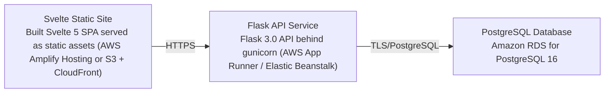

# Deployment Guide

> Maintained by QuorQ AI SDLC. Text between `sdlc:auto` markers is regenerated; anything outside them is yours and is kept.

<!-- sdlc:auto:start how-it-deploys -->
Pushes to `main` run `.github/workflows/deploy.yml`, which builds the API image (if there is a backend) and deploys the SPA to AWS Amplify. Commits touching only `docs/sdlc/**` don't deploy. Deployments can also be started from the platform's Deployment tab.
<!-- sdlc:auto:end how-it-deploys -->

<!-- sdlc:auto:start environments -->
| Name | Service | Runtime | Scaling | Environment |
|---|---|---|---|---|
| Svelte Static Site | Built Svelte 5 SPA served as static assets (AWS Amplify Hosting or S3 + CloudFront) | Static files / CDN | CDN edge, no app scaling | dev |
| Flask API Service | Flask 3.0 API behind gunicorn (AWS App Runner / Elastic Beanstalk) | Python 3.12 | Single small instance for dev, horizontal if needed | dev |
| PostgreSQL Database | Amazon RDS for PostgreSQL 16 | PostgreSQL 16 | Single small managed instance | dev |
<!-- sdlc:auto:end environments -->

<!-- sdlc:auto:start live -->
_Not deployed yet._
<!-- sdlc:auto:end live -->

<!-- sdlc:auto:start topology -->

<!-- sdlc:auto:end topology -->
